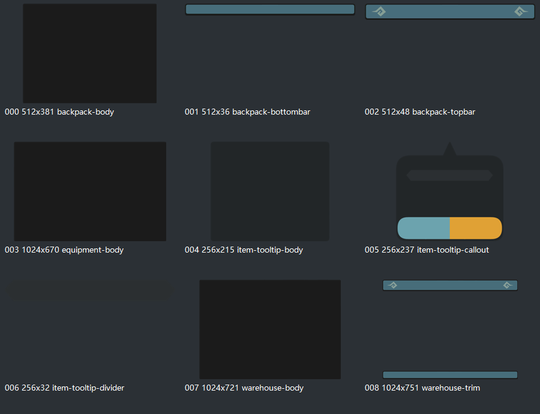
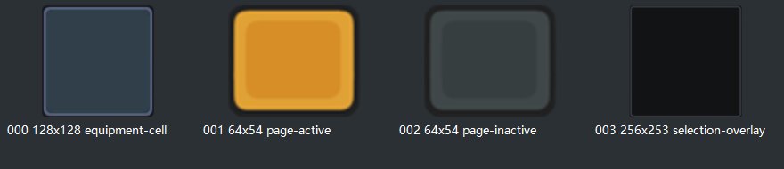
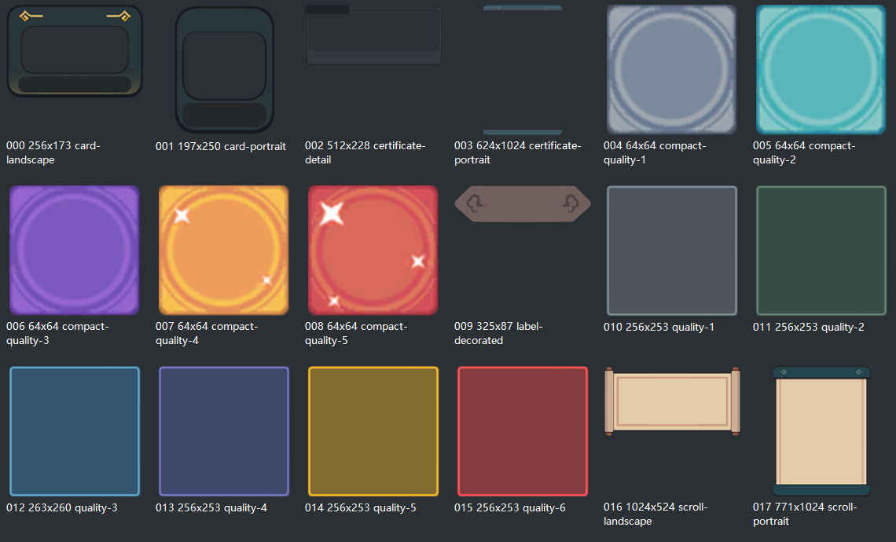
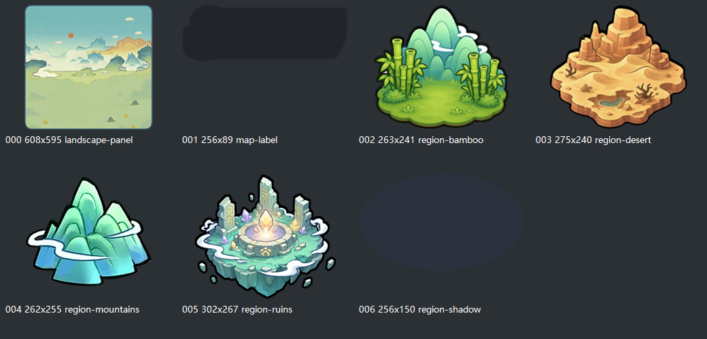

# 修仙素材候选

这是用户指定素材的精选参考副本，不是运行时资源，不应被预制体或游戏代码直接引用。当前共 52 张源图副本：首轮 14 张，本轮补充 38 张。

来源：`E:\资源\修仙宗门搜打撤\extracted_assets\images`。原提供路径中的 `extracted\_assets` 在本机不存在，已核实实际目录为 `extracted_assets`。

- `items/`：10 张物品外观候选。文件名描述图像，不代表已批准的游戏名称、属性、形状、药效或装备类别。
- `controls/`：4 张网格、搜索和锁定状态候选。公共动作优先复用项目已有图标，不为相同功能再引入另一套。
- `panels/`：9 张仓库、背包、装备与详情底板/边饰。
- `grids/`：4 张装备格、深色选中层和分页底；基础空格仍在 `controls/storage-cell.png`，没有重复复制。
- `frames/`：18 张框，包括 6 张大品质框、5 张小品质框，以及 7 张可用于凭证/卡片的空白框、卷轴或标签。
- `maps/`：7 张山水面板、竹林/群山/荒漠/遗迹区域图块、阴影与空白标题底。
- `items-00.png`：10 张物品的浏览总览，不参与图集打包。
- `panels-00.png`、`grids-00.png`、`frames-00.png`、`maps-00.png`：本轮分类浏览图，不参与图集打包。
- `manifest.json`：52 张源图各自的原文件、语义副本、像素尺寸、SHA-256、候选用途/注意项，以及四张重点 UI 参考图。

没有整包复制 982 张图片，也没有导入字体、原游戏配置、音频、角色肖像、带字按钮或整页贴图。已有公共品质框保留原 UUID；新增品质框只是参考备选，不替换当前运行时资源。

## 推荐组合

| 用途 | 优先候选 | 注意 |
| --- | --- | --- |
| 仓库 | [底板](panels/warehouse-body.png) + [上下边饰](panels/warehouse-trim.png) + [空格](controls/storage-cell.png) | 边饰中间透明，不能单独当完整底板 |
| 背包 | [底板](panels/backpack-body.png) + [上沿](panels/backpack-topbar.png) + [下沿](panels/backpack-bottombar.png) | 与仓库分区相同风格，实际格数由规则/配置决定 |
| 装备格 | [装备单格](grids/equipment-cell.png) | 128×128；不从图像决定装备槽数 |
| 凭证展示 | [横向卷轴](frames/scroll-landscape.png) 或 [竖向卷轴](frames/scroll-portrait.png) | 原图无字，可另放文本；没有找到原名明确标为凭证的专用框 |
| 凭证详情 | [横卡框](frames/card-landscape.png)、[竖卡框](frames/card-portrait.png)、[长竖边饰](frames/certificate-portrait.png) | 原用于其他面板，现只作为外观候选，不引入凭证业务 |
| 品质框 | `frames/quality-1.png` 至 `quality-6.png`；小框 `compact-quality-1.png` 至 `compact-quality-5.png` | 大框约 256 像素，小框 64 像素；品质映射沿用本项目，不照搬原游戏 |
| 地图 | [山水底图](maps/landscape-panel.png) + `maps/region-*.png` | 底图仅 608×595，非 1280×720 横屏全图，不宜直接拉伸；区域图不定义节点连线或功能 |

本轮比对了原纹理和 Sprite。山水原纹理为 622×1024，含大量白色留白；这里选的是已有 608×595 Sprite，没有另外裁改源图。截图中的横屏森林完整地图未在本轮检查范围内找到。

大面板接入前还需按实际九宫格/拼接方式验证缩放、透明边和边饰比例，本目录不宣称这些检查已经通过。

## 分类预览

源目录 README 说明素材来自第三方游戏运行缓存。用户允许本项目参考和选用这些本地素材，但本次未核实对外发布所需的权利；正式使用前仍需确认来源许可或替换。现有代码不依赖这些候选文件。

现行选型与开发边界见 [资源选型记录](../../../document/09_整合开发/资源选型与UI参考_2026-11-09.md)，下一阶段方案见 [阶段 3 确认包](../../../document/09_整合开发/阶段3_三空间与物品确认包.md)。本目录不维护另一套需求。

校验：客户端根运行 `node tools/check-reference-assets.cjs`。加 `--source` 会额外比较本机外部源图；不加该参数时不依赖外部目录，可在其他开发机检查副本和 UI 参考的完整性。
