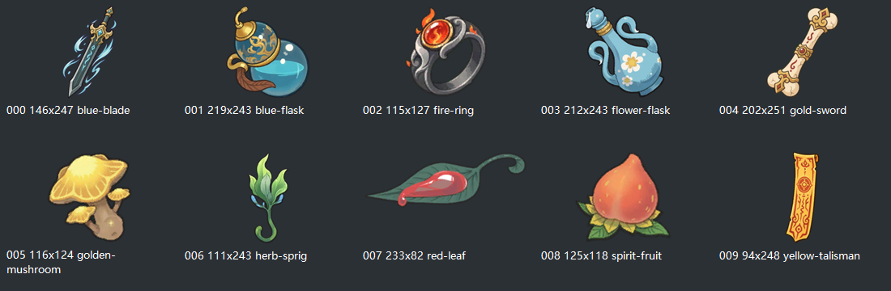
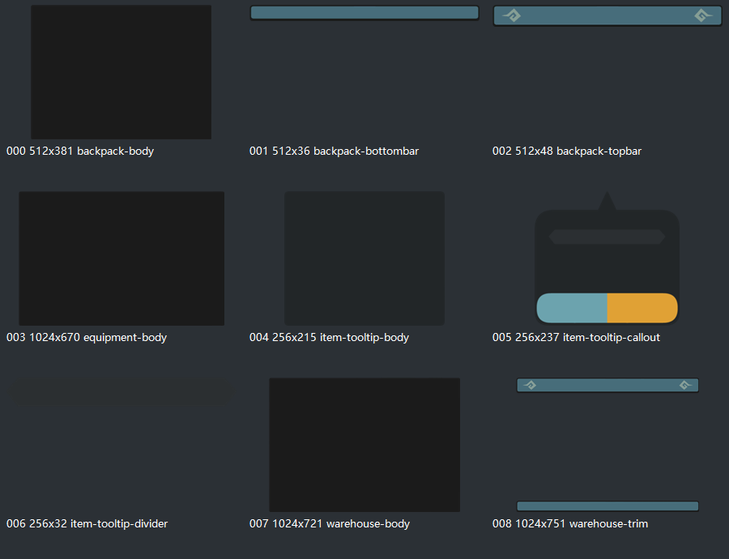
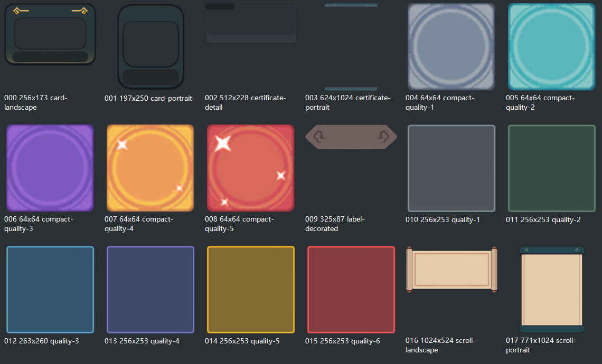
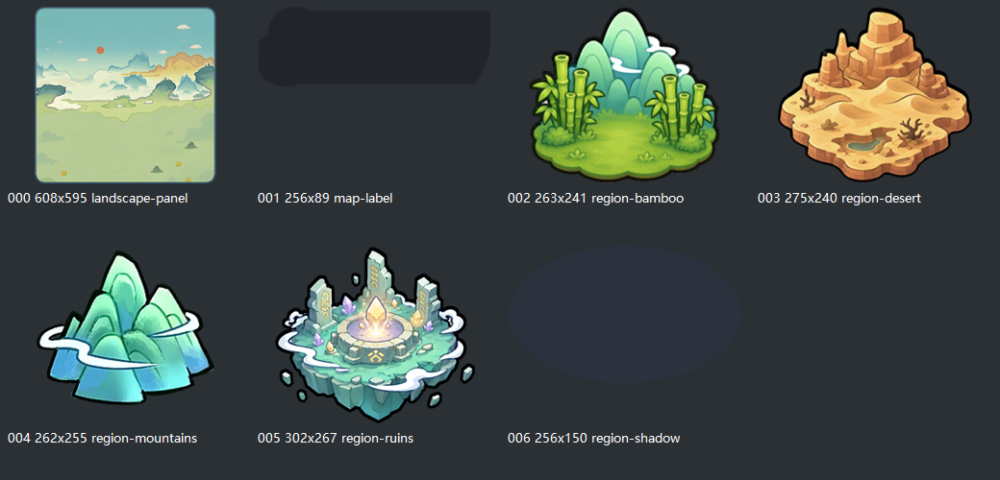

# 资源选型与 UI 参考

日期：2026-11-09。依据：用户明确提供本地修仙资源和 `document/UI参考` 效果图，允许后续开发选用和参考。唯一开发入口仍为 [README](README.md)。

## 1. 实际路径与核查范围

提供的 `E:\资源\修仙宗门搜打撤\extracted\_assets\images` 不存在；实际资源在 `E:\资源\修仙宗门搜打撤\extracted_assets\images`，下分 `sprites` 与 `textures`。

本机枚举共 620 张 Sprite PNG、362 张 Texture PNG。首轮查看全部 27 张 UI 参考的缩略总览，对储物、物品、通用控件等相关 213 张 Sprite 做缩略目检，重点展开四张效果图。随后按用户要求补查仓库/背包/地图/框，新增目检 166 张 Sprite、288 张相关 Texture，累计 379 张不重复 Sprite；细节见第 6 节。没有逐张验收其余图片、角色动画或全部图集切分质量，不沿用源目录历史校验冒充本轮成绩。

原素材、原效果图及冻结快照均未移动、覆盖或重新裁切。本轮没有读取并照搬第三方游戏配置。

## 2. 重点效果图与取舍

| 原图 | 采用的参考方向 | 不采用的内容 |
| --- | --- | --- |
| [仓库并排](../UI参考/599d74abc3a1b8fc3225f603c415a8a6.jpg) | 左侧随身空间，右侧局外统一库存；同屏比较和移动 | 双币、仓库付费锁页、负重数值、药品堆叠、截图中的实际容量 |
| [地面拾取并排](../UI参考/63528643263e811625935ece75e2eb9c.jpg) | 随身与节点待拾取同屏，分清物品实际位置 | 原游戏装备槽数量、默认全部揭示和分页数量 |
| [整备信息层次](../UI参考/8d46b68d4f1163b31e0412510f6e793d.jpg) | 装备、即时取用物和大容器分区；属性摘要与出发动作清晰 | 卡组、天赋替换、速食修理、另一套角色/装备规则 |
| [整备布局变体](../UI参考/bc28e91b799f8363ad1ca08717d6a138.jpg) | 满载状态下仍能看到装备和随身容器 | 原图道具数量、保护范围、卡牌操作和各项数值 |

后续按 1280×720 重排，不将原图等比缩小后直接贴进游戏。原图手机系统状态栏、原游戏名称和业务文案不进入预制。保留 `UIManager/UIBaseView/ElementMapper` 与现有横屏适配，不新增 UI 框架。

## 3. 精选候选与放置位置

首轮精选 14 张原 PNG 的字节不变副本放入 [候选目录](../../art/reference/cultivation/README.md)，随后补充 38 张，当前共 52 张；原始路径、像素尺寸和哈希见 [清单](../../art/reference/cultivation/manifest.json)。下表保留首轮内容，本轮新增分类见第 6 节。

| 分类 | 数量 | 文件/用途 |
| --- | --- | --- |
| 材料外观 | 4 | `herb-sprig`、`spirit-fruit`、`golden-mushroom`、`red-leaf` |
| 瓶状外观 | 2 | `blue-flask`、`flower-flask`；不是已确认的血/蓝药对应关系 |
| 武器外观 | 2 | `gold-sword`、`blue-blade`；不引入新装备属性 |
| 戒指/符纸外观 | 2 | `fire-ring`、`yellow-talisman`；不据此新增法宝、符箓效果或可保护类别 |
| 储物控件候选 | 4 | `storage-cell`、`search`、`lock-closed`、`lock-open` |

物品候选总览：

缺口仍有：书籍、修补工具、明确的纳虚囊外观、旋转/禁放反馈、部分新核技能与敌人图像。本轮不拿不相干图标宣称全部资源齐全；正式选用前检查实际缩放、透明边、辨认度和权利来源。

只保存精选参考，不将 982 张图全部加入 `assets`。公共品质框与动作图标优先复用现有资源。将来实际接入时，物品小图进入 `assets/ui/atlas/module/inventory`，大面板进入 `assets/ui/texture/inventory`，新增预制进入 `assets/ui/prefab/module/inventory`；这些是目标位置，本轮尚未创建运行时目录或绑定。

## 4. 发布与规则边界

源目录 README 将该资源说明为第三方小游戏运行缓存，不是本项目工程。用户允许选用本地素材不等于本次已核实对外发布权利；本轮仅归档候选，正式发布前确认来源许可或替换。

图片提供外观与布局参考，不提供容量、形状、堆叠、装备位、药效、保护和交易规则。阶段 3 待定参数集中在 [R06 确认包](阶段3_三空间与物品确认包.md)，未写入现行确认基线或运行配置。

## 5. 首轮交付与验证

- 新增参考候选、逐文件清单、校验脚本及阶段 3 R06 推荐包。
- 校验命令：`node tools/check-reference-assets.cjs`；本机加 `--source` 检查外部源图与副本字节一致。
- 本轮 `--source` 实测通过：14 张候选的 PNG 头、尺寸、哈希和外部源图，以及四张重点 UI 原图哈希。精选物品总览已打开目检。
- 文档只读归档校验通过：73 来源、146 次哈希、26 份现行 Markdown、478 个本地链接、4 份 JSON、11 项基线和 4 处入口。`git diff --check` 通过；新增文本另查无非预期尾随空白。
- 未改游戏功能代码、预制、运行时资源、Excel、生成 schema/bin 或任何存档；没有执行导表、清档或阶段 3 功能接入。
- 原始文档和冻结快照仍由只读归档校验检查；本轮不将此前游戏测试计为新实现验收。

## 6. 补查仓库、地图、背包与框

用户要求再查仓库地图、背包底图、格子和凭证框。本轮补查 Sprite 与原 Texture，排除带业务文字的整页截图、原游戏按钮、字体纹理与重复图集；没有找到名称明确标为“凭证”的专用框，因此将可用空白框作为凭证展示候选，同时单列品质框，不擅自解释成新增凭证系统。

| 新增分类 | 数量 | 优先使用方向与边界 |
| --- | --- | --- |
| `panels` | 9 | 仓库底板 1024×721/边饰 1024×751；背包底板 512×381/上沿 512×48/下沿 512×36；装备与物品详情底板 |
| `grids` | 4 | 装备格 128×128、深色选中层、64×54 分页底两态；已有 64×64 基础空格不重复复制 |
| `frames` | 18 | 六大品质框、五小品质框；七种空白卡框、卷轴、长框和标签，可用于凭证外观，但不是源游戏凭证专用素材 |
| `maps` | 7 | 608×595 山水面板、竹林/群山/荒漠/遗迹四区域、阴影与空白地图标签 |

推荐组合：仓库用底板/上下边饰/基础格分层；背包用底板/上沿/下沿分层；凭证可选无字横/竖卷轴，不把带原业务字样的招募或报告整页导入。完整文件链接和四张分类预览放在 [候选目录](../../art/reference/cultivation/README.md)，不再另建平行素材清单。

地图原 Texture 为 622×1024，含大量白色留白；优先选择原已导出的 608×595 Sprite。该图有固定外框，不能冒称可直接满屏的 1280×720 背景；截图中的完整横屏森林地图未在本轮检查范围内找到。区域图块只是美术，不批准节点功能、连线、掉落或地图规则。

本轮没有重新切图、抹字、替换现有品质框 UUID、绑定预制或导入运行图集。素材缩放、九宫格、透明边组合、正式发布来源仍须在实际接入时验证；游戏代码、配置及存档保持不变。

新增副本与原图已逐张比较，`node tools/check-reference-assets.cjs --source` 通过：52 张 PNG 的尺寸/哈希、52 个外部原文件哈希、四张重点 UI 参考哈希。四张分类总览已打开目检。

补查后的只读归档校验通过：73 来源、146 次哈希、26 份现行 Markdown、483 个本地链接、4 份 JSON、11 项基线、4 处入口；候选目录自身链接、`git diff --check` 与新增文本空白检查通过。本轮未运行游戏逻辑/浏览器测试，没有功能代码或运行时资源改动。

## 7. 阶段 3 批准后的实际接入

以上第 1-6 节保留选型准备时的历史范围；用户随后明确“阶段3确认包 全部按推荐来 开始开发”，当前状态以本节与 [阶段 3 实施记录](阶段3_接入与验证_2026-11-09.md) 为准，不能继续将“仅参考/未接入”当作当前运行状态。

- 运行时选取 22 张现有 PNG，全部原字节复制，未生成、重绘或加工位图。小图、格子、框和锁放 `assets/ui/atlas/module/inventory`；仓库底板、背包底板、上沿和控件底板放 `assets/ui/texture/inventory`。资源移动保留 `.meta` UUID，预制与依赖表同步。
- `tools/build-inventory-prefab.cjs` 可重建选取副本与两张横屏预制绑定，不依赖临时缩略索引；外部根目录可用 `INVENTORY_SOURCE_ROOT` 指定。实际来源、SHA-256、代图说明见 `assets/ui/atlas/module/inventory/sources.json`，不修改 52 张历史候选及其原始清单。
- 候选 `gold-sword` 虽曾归为武器，目检实为卷轴。因此武器运行键暂沿用原键但显示 `blue-blade` 真刀剑图片；卷轴仅作剑/土书外观。修补用符纸、纳虚囊用包裹，均明确是临时代图，不赋予原游戏效果。后续精修应按实际外观重命名候选与运行键，不破坏本轮哈希追溯。
- 瓶图、矿晶、灵草、小材料、卷轴、刀剑与容器等由本项目已批准配置赋予语义；图片不决定形状、药效、学习或失败保护。没有把地图候选接成正式首图，没有新增凭证玩法。
- `node tools/check-reference-assets.cjs --source` 实测通过 52 张候选、四张重点 UI 参考及 22 张运行 PNG/外部源哈希；默认浏览器三种视口检查图像已加载且实际图标区域存在非空图片像素，并目检桌面/手机截图。正式发布素材权利仍未核实。

## 8. 六档品质框实际接入

2026-11-09 用户先明确六档品质与九宫拉伸，随后指定本项目 `art/reference/cultivation/frames` 及截图红框中的六张大框，要求加入现有物品显示。此次是实际资源/UI 接入，不再仅为素材候选或文档准备。

| 品质 | 原图与运行图文件名 | 原图尺寸 |
| --- | --- | --- |
| 普通白 | `quality-1.png` | 256×253 |
| 优秀绿 | `quality-2.png` | 256×253 |
| 精良蓝 | `quality-3.png` | 263×260 |
| 稀有紫 | `quality-4.png` | 256×253 |
| 史诗金 | `quality-5.png` | 256×253 |
| 传说红 | `quality-6.png` | 256×253 |

- 原图位于 `art/reference/cultivation/frames`，原字节复制至 `assets/ui/atlas/module/inventory`；六张新增 PNG 各有 `.meta` UUID，既有资源 UUID 不变。`sources.json` 增加六条来源与 SHA-256，当前运行素材清单为 28 张；52 张参考候选与冻结快照保持不变。无生成、重绘、调色或整包导入。
- `tools/build-inventory-prefab.cjs` 可重建六张资源、三张战斗业务 prefab 的相应绑定；新增选中描边使用派生节点 ID，保留既有节点 ID。运行依赖经 `tools/ui-assets.cjs --write` 同步。
- 六图 `.meta` 均使用 `sizeGrid: [8,8,8,8,0]`，上下左右 8 像素固定，中部拉伸。`NewInventoryPanel` 同步为原 PNG 预览补齐纹理九宫参数，并刷新已创建的普通绘制指令；实测检查 `Draw9GridTextureCmd`，不以仅设置元数据代替真正九宫绘制。
- 装备位、三空间、仓库/地面和结算列表使用整件物品尺寸的框；物品旋转后框保持正向、按新宽高拉伸，物品图片继续旋转。拖动时仍显示品质框，合法/禁放/选中用独立描边或落格反馈，不改变品质颜色；落点预览也改用矩形框，不再出现旧圆形小框。空装备位保留原网格，不显示品质框；战斗斗法匣现有物品图标也带框，空位不带框，图标与文字分区避免修补工具名称被遮挡。
- 展示沿用现有六档 `EQuality`。储物模板类型允许可选品质，但本轮不改源表、schema、运行配置包或实例结构；现有模板没有品质字段，界面仅回退普通白框，不把显示回退写回存档，不依据名称、物品类别或图片颜色编造品质。

验证入口与截图：

- `tsc --noEmit`：全工程类型检查。
- `pwsh -NoProfile -File tools/test-skill-battle.ps1`：逻辑、储物事务、prefab 与资源依赖回归；prefab 检查补充六张原图字节一致、九宫参数与独立选中层。
- `node tools/check-reference-assets.cjs --source`：52 张候选、四张 UI 参考及 28 张运行图来源哈希。
- `node tools/test-inventory-quality-browser.cjs`：桌面 1280×720、宽屏 1920×1080、手机 844×390；六档加载、实际九宫绘制指令、边缘像素、六种横竖尺寸、选中层、无/非法品质回退及不写存档/重载。截图在 `bin/inventory-quality-browser`；`*-six-tiers.png` 只在隔离测试页面给控件临时指定六档展示，不是现有物品已分配六种品质的证据。
- `node tools/test-inventory-drag-browser.cjs`：原生鼠标/触摸、旋转/自动旋转、取消/非法落点、换装、原子保存与到期三视口回归，并检查实际可见品质框的九宫绘制、完整尺寸与无红绿染色；截图在 `bin/inventory-drag-browser`。
- `node tools/test-new-inventory-browser.cjs`：三视口储物、实际战斗用药、修补、地面、结算与重载；截图在 `bin/stage3-browser`。

本轮实测以上检查全部通过：类型检查；143 项旧逻辑、53 组阶段 1、53 组阶段 2、36 组储物事务；5 prefab/82 张运行图片；52 张候选、四张 UI 参考、28 张运行图源哈希；六档品质专项、原生拖拽与完整储物流程三视口。战斗截图检查同时断言图标/文字不相交、已消费/空物品位不残留品质框，桌面与手机的六档、完整占格、横向拖动及战斗截图已目检。`git diff --check` 与现行文档只读校验通过。未重跑阶段 1/2 独立浏览器与完整 UI 框架浏览器，不将其历史成绩列为本轮验收。

本次不清档、不迁移、不改变模板品质、属性、容量、掉率、价格或阶段 4 范围。正式发布素材许可仍未核实，实体设备与 IDE 发布包不在浏览器测试的验收范围。

## 9. IDE 运行与预览颜色差异修复

2026-11-09 用户反馈 IDE 内嵌运行面板变灰、格子变浅、刀剑偏粉且透明区域发白，与此前预览截图不一致。此前验收只覆盖直接 PNG 预览，未覆盖 IDE 导入链路，因此没有发现该问题；第 8 节的历史浏览器成绩不能作为 IDE 颜色正确的证据。

复现及根因：

- 使用 IDE 已启动的实际完整工程浏览器入口 `http://127.0.0.1:18092`，在隔离浏览器上下文复现同样偏色，不操作用户 IDE 存档。
- 多数储物图片 `.meta` 只有 UUID。IDE 生成的纹理元数据为 `type: 0`，没有 `sRGB`、没有 `pma`；实测物品和面板纹理 `_premultiplyAlpha: false`，导致颜色空间和 2D 透明混合不匹配。直接 PNG 预览没有经过 IDE 导入，Laya 的普通 2D 图片加载默认启用 sRGB/预乘透明，因此看起来正确。
- 以本机引擎 `Texture2DLoader`、`TextureLoader` 及 `engine/types/editor-env.d.ts` 为核对依据。预览确实额外关闭 WebGL2，但本轮保持实际工程 WebGL2 开启也能恢复正确颜色，因此没有用禁用 WebGL2、改全局引擎或重新调色来处理。

修复范围：

- 28 张储物运行图片及页面使用的公共按钮 `.meta` 明确设为 `textureType: 2`、`sRGB: true`、`premultiplyAlpha: true`；保留 UUID、已有九宫和其他设置。六张品质框此前已有精灵类型，这次补齐明确的颜色/透明参数。
- `tools/build-inventory-prefab.cjs` 复制资源时同步保留并写入这些导入参数，防止重建后丢失；`tools/check-reference-assets.cjs` 增加对应断言。
- 未修改 PNG 原字节、品质映射、物品属性、56 格距、预制布局、配置源表/生成包或存档。未清档、未迁移，不改其他未涉及模块的纹理。

本轮验证：

- `node tools/test-inventory-colors-ide.cjs`：比较直接 PNG 预览与 IDE 实际完整工程浏览器入口，桌面 1280×720、宽屏 1920×1080、手机尺寸 844×390 全部通过。逐张检查 29 张纹理实际 sRGB/预乘参数，IDE 导入元数据为精灵类型；在深浅两种背景对照实际图片像素，并确认绘制不写存档。画布内 RGB 平均差分别约为 0.10、0.08、0.12（满量程 255）；不把两个宿主页面不同的画布外留边底色混入纹理颜色断言。截图在 `bin/inventory-colors-ide`，桌面/手机完整库存截图已目检。
- `tsc --noEmit`、`tools/test-skill-battle.ps1`、`tools/test-inventory-quality-browser.cjs` 通过；包括 143 项旧逻辑、53 组阶段 1、53 组阶段 2、36 组储物事务、5 prefab/82 图片及六档九宫专项三视口。28 张运行图片与其来源 SHA-256、导入元数据已单独核验通过。
- `node tools/check-reference-assets.cjs --source` 本轮未整体通过：用户工作区参考目录中新加入、尚未在精选清单登记的 `items/itemui_*` 图片触发原有“未登记参考图”断言。未删除、移动这些文件，也不将该失败写成通过；运行图单独核验不代替完整参考目录校验。

验证边界：测试使用 IDE 的完整工程资源服务及实际导入结果，不是修改后的独立预览冒充正式入口；未直接操控/截图用户当前 IDE 内嵌窗口，未构建发布包或验收实体手机。IDE 正在运行的页面需重新运行以完整重新加载纹理。正式发布素材许可仍待核实。
